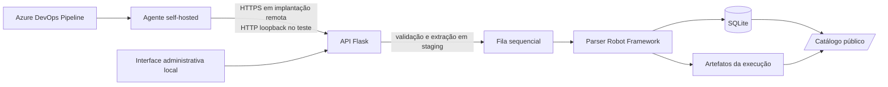

# Arquitetura e controles de segurança

Este documento descreve como o Robot Report Generator recebe resultados do
Robot Framework, processa e persiste esses dados e disponibiliza os relatórios.
Ele registra o comportamento implementado e o cenário local exercitado para
apoiar a revisão da equipe de segurança. Não é uma auditoria nem uma declaração
de conformidade.

## Resumo do sistema

O sistema é uma aplicação Python com interface web Flask, parser do XML do
Robot Framework e armazenamento SQLite. Resultados podem chegar pela interface
local, pela CLI ou pela API de automação usada por pipelines. A pipeline envia
um ZIP com `output.xml` e evidências; o servidor valida o pacote, coloca a
importação em uma fila sequencial e atualiza o banco e o catálogo.

## Fluxos de entrada e processamento

### Pipeline de automação

1. O template `azure-pipelines/robot-report-import.yml` compacta o diretório de
   resultados e envia o ZIP a `POST /api/automation/imports`.
2. A requisição inclui `system_id`, `system_name`, `system_version` e o token
   de ingestão no cabeçalho `Authorization: Bearer`.
3. O servidor valida os metadados, prepara o ZIP e exige que o pacote contenha
   `output.xml` na raiz ou em uma única pasta. A data da execução vem do XML.
4. Se não houver outra importação ativa, o servidor adiciona o trabalho à fila
   e responde `202` com um identificador. A pipeline consulta
   `GET /api/automation/imports/{import_id}` até a conclusão ou erro.
5. O worker chama o caminho de importação normal da CLI, que interpreta o XML,
   calcula métricas e grava a execução no SQLite. O catálogo passa a refletir
   esses dados.

A fila e os estados de trabalho ficam em memória durante a sessão do servidor.
O histórico e os artefatos persistidos ficam no disco. A API não aceita um
arquivo HTML da pipeline: ela importa o XML e as evidências para gerar as
visualizações a partir do catálogo.

### Interface administrativa e CLI

A interface local permite pré-visualizar e confirmar uploads, consultar o
histórico, remover execuções, criar/restaurar backups e limpar artefatos órfãos.
Essas operações são protegidas pelo token de sessão da interface. A CLI também
pode importar diretamente de arquivos ou diretórios no host em que é executada.

## Dados e armazenamento

| Dado | Uso e localização |
|---|---|
| `output.xml` | Estrutura das suítes, resultados, mensagens, tempos, metadados e data da execução. |
| Evidências do ZIP | Arquivos relacionados aos resultados, armazenados com a execução mais recente do sistema. |
| Metadados da pipeline | ID, nome e versão do sistema; enviados junto do ZIP. |
| Histórico e snapshots | SQLite no caminho definido por `ROBOT_REPORT_DATABASE` ou no padrão `robot-results/report_history.sqlite3`. |
| Artefatos | Diretório `executions/` ao lado do arquivo SQLite; inclui o ZIP original e os resultados da execução corrente. |
| Upload pendente | Diretório temporário `.pending-*` sob a raiz de artefatos; uploads pendentes expiram após 30 minutos e são limpos durante operações do serviço. |

O identificador de execução é o SHA-256 do conteúdo de `output.xml`; o reenvio
do mesmo XML não cria uma execução duplicada. Quando uma nova execução vira a
mais recente do sistema, os artefatos armazenados da execução anterior são
removidos, embora seu resumo histórico permaneça no SQLite.

## Autenticação, autorização e exposição

### API de automação

- `POST /api/automation/imports` e `GET /api/automation/imports/{id}` exigem o
  bearer token configurado por `ROBOT_REPORT_INGEST_TOKEN` no servidor.
- A comparação do token é feita em tempo constante. Se o segredo não estiver
  configurado, a autenticação não passa.
- O token de ingestão é separado do token da interface. O pipeline deve guardar
  seu valor em variável secreta do Azure DevOps; não deve ser gravado no YAML.
- A API permite importar resultados e consultar o estado dos trabalhos; não é
  um token de login para a interface administrativa.

### Interface e APIs administrativas

- O token de sessão é gerado aleatoriamente ao iniciar o servidor. `gui.py`
  imprime uma URL com o token no fragmento; o JavaScript o transfere para
  `sessionStorage` e o envia em `X-Session-Token` nas chamadas de API.
- O servidor também verifica a origem local configurada, o cabeçalho `Origin`
  e rejeita requisições marcadas como cross-site. A interface usa cookie de
  sessão para proteger páginas de relatórios administrativos.
- Endpoints de importação web, histórico, backup/restauração, manutenção,
  cancelamento e encerramento ficam atrás das verificações administrativas.
- O token da interface e a URL que o contém devem ser tratados como credenciais
  de sessão e não compartilhados.

### Catálogo público

`/public`, `/public/api/*` e `/public/reports/*` permitem leitura sem login; a
API pública de PDF também aceita gerar/download de PDFs. A página mostra nomes,
versões, métricas, histórico resumido e o conteúdo detalhado do relatório
atual, incluindo mensagens e informações ambientais presentes no XML. O
catálogo deve ser considerado intencionalmente público: não inclua dados que
não possam ser vistos por qualquer pessoa com acesso de rede ao endereço.

O middleware restringe essas rotas a métodos de leitura, exceto a geração de
PDF que aceita `GET` e `POST`. As rotas de mudança de estado continuam
protegidas pelo token local ou pela autenticação de ingestão.

## Validação de arquivos e execução

- Limite padrão do ZIP recebido: 500 MiB, ajustável por
  `ROBOT_REPORT_MAX_UPLOAD_BYTES`.
- Limite padrão de conteúdo descompactado: 1 GiB, ajustável por
  `ROBOT_REPORT_MAX_UNPACKED_BYTES`.
- Máximo de 10.000 membros por ZIP. Caminhos absolutos, traversal (`..`),
  nomes duplicados, links e tipos de arquivo não regulares são rejeitados.
- O nome de arquivo enviado pelo cliente não determina o caminho de destino;
  o servidor define os caminhos em staging.
- Metadados são validados: IDs de sistema aceitam letras minúsculas, números e
  hífens; nome e versão são obrigatórios e limitados a 200 caracteres na API de
  automação.
- O servidor só permite um trabalho de importação ativo por vez. Após o
  processamento, a pasta temporária do trabalho é removida.

## Cenário testado e diferença para produção

O teste ponta a ponta usou Azure DevOps Services, um agente self-hosted Linux e
o gerador na mesma máquina. O agente enviou para `127.0.0.1:5001`, em HTTP, com
um banco SQLite temporário. Isso validou o fluxo funcional sem expor o servidor
à rede externa; `127.0.0.1` só é acessível no próprio host e não serve para um
agente hospedado pela Microsoft ou em outra máquina.

Para uma implantação acessível remotamente, o cliente e o servidor precisam
usar uma URL HTTPS alcançável pelo agente, normalmente terminada em proxy
reverso TLS. O app de `gui.py` usa o servidor de desenvolvimento Werkzeug; a
configuração de referência não demonstra um desenho de produção, controles de
rede, gestão operacional de segredos ou isolamento de dados entre clientes.
Esses pontos devem ser avaliados pela equipe responsável antes da publicação.

O `docker-compose.yml` publica a porta 5000 no host e configura o serviço para
escutar em `0.0.0.0`; portanto, o alcance efetivo depende também do firewall,
da rede e da configuração de publicação do host. Essa topologia é diferente
do teste em loopback.

## Controles HTTP observados

As respostas configuram `Cache-Control: no-store`, `X-Content-Type-Options`,
`Referrer-Policy`, `X-Frame-Options` e uma Content Security Policy. As páginas
de relatório embutidas recebem política de sandbox. Estes cabeçalhos reduzem
algumas classes de exposição no navegador, mas não substituem HTTPS,
autenticação, autorização nem controles de rede.

## Referências no repositório

- `core/web_app.py`: rotas, autenticação e políticas HTTP.
- `core/import_service.py`: upload, limites e extração segura do ZIP.
- `core/web_jobs.py`: fila e execução do processamento.
- `core/sqlite_store.py`: persistência, histórico e deduplicação.
- `azure-pipelines/robot-report-import.yml`: envio e consulta de estado pela pipeline.
- `docs/TESTE_AZURE_DEVOPS_LOCAL.md`: procedimento e resultados do teste local.
